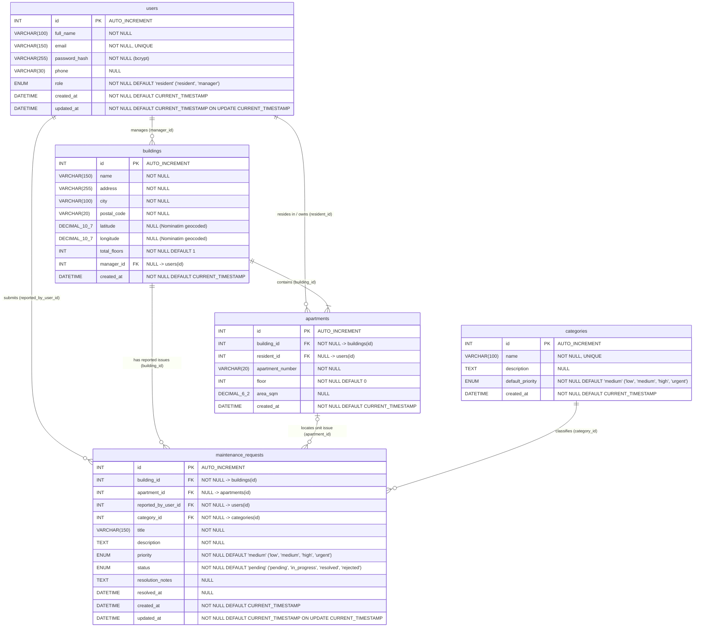

# Haustor.ba — Apartment Building Management & Maintenance Reporting

**Course:** IT-2001 Web Programming  
**Author:** Tarik Sorguč  

---

## 1. Project Overview & Mission

**Haustor.ba** is a modern web application designed to streamline communication and maintenance workflows within residential apartment buildings across Bosnia and Herzegovina. Traditional building management often suffers from fragmented communication channels (bulletin boards, messaging groups, phone calls) and a lack of transparency regarding reported repairs.

**Our Mission:** To provide residents and building managers (*upravitelji* / HOA representatives) with a centralized, transparent, and easy-to-use platform for reporting maintenance issues, tracking repair statuses in real time, and managing residential building units efficiently.

---

## 2. Core Entities & Database Schema

The system is built around five core relational entities (for full data dictionaries and foreign key constraints, see [`docs/DATABASE_SCHEMA.md`](docs/DATABASE_SCHEMA.md)):

1. **Users (`users`)** — Registered individuals in the system, storing profile details, credentials (bcrypt password hashes), and assigned access roles (`resident` or `manager`).
2. **Buildings (`buildings`)** — Residential apartment buildings managed on the platform, including street address, city, postal code, geocoded coordinates, and assigned manager metadata.
3. **Apartments (`apartments`)** — Individual residential units linked to a specific building and associated with resident users (apartment number, floor, square footage).
4. **Categories (`categories`)** — Classification types for building issues (e.g., *Plumbing & Water*, *Electrical & Lighting*, *Elevator*, *Common Area Cleaning*, *Heating/HVAC*, *Structural & Roof*) with priority indicators.
5. **Maintenance Requests (`maintenance_requests`)** — Issue reports submitted by residents tied to a building, apartment (or common area), and category, tracking description, priority, status (`pending`, `in_progress`, `resolved`, `rejected`), timestamps, and manager resolution notes.

### Entity-Relationship Diagram (ERD)



### Table Specifications

#### 1. `users`
| Column | Data Type | Nullability | Key / Constraints | Description |
| :--- | :--- | :--- | :--- | :--- |
| `id` | `INT UNSIGNED` | `NOT NULL` | **PK**, `AUTO_INCREMENT` | Primary user identifier |
| `full_name` | `VARCHAR(100)` | `NOT NULL` | — | Full name of the resident or manager |
| `email` | `VARCHAR(150)` | `NOT NULL` | **UNIQUE** | Login email address |
| `password_hash` | `VARCHAR(255)` | `NOT NULL` | — | Bcrypt password hash |
| `phone` | `VARCHAR(30)` | `NULL` | — | Contact phone number |
| `role` | `ENUM('resident', 'manager')` | `NOT NULL` | `DEFAULT 'resident'` | User access role |
| `created_at` | `DATETIME` | `NOT NULL` | `DEFAULT CURRENT_TIMESTAMP` | Registration timestamp |
| `updated_at` | `DATETIME` | `NOT NULL` | `DEFAULT CURRENT_TIMESTAMP ON UPDATE CURRENT_TIMESTAMP` | Last update timestamp |

#### 2. `buildings`
| Column | Data Type | Nullability | Key / Constraints | Description |
| :--- | :--- | :--- | :--- | :--- |
| `id` | `INT UNSIGNED` | `NOT NULL` | **PK**, `AUTO_INCREMENT` | Primary building identifier |
| `name` | `VARCHAR(150)` | `NOT NULL` | — | Building / entrance display name |
| `address` | `VARCHAR(255)` | `NOT NULL` | — | Street address and number |
| `city` | `VARCHAR(100)` | `NOT NULL` | — | City / municipality |
| `postal_code` | `VARCHAR(20)` | `NOT NULL` | — | Postal / ZIP code |
| `latitude` | `DECIMAL(10,7)` | `NULL` | — | Nominatim geocoded latitude |
| `longitude` | `DECIMAL(10,7)` | `NULL` | — | Nominatim geocoded longitude |
| `total_floors` | `INT` | `NOT NULL` | `DEFAULT 1` | Number of floors in the building |
| `manager_id` | `INT UNSIGNED` | `NULL` | **FK** -> `users(id)` (`ON DELETE SET NULL`) | Assigned building manager |
| `created_at` | `DATETIME` | `NOT NULL` | `DEFAULT CURRENT_TIMESTAMP` | Record creation timestamp |

#### 3. `apartments`
| Column | Data Type | Nullability | Key / Constraints | Description |
| :--- | :--- | :--- | :--- | :--- |
| `id` | `INT UNSIGNED` | `NOT NULL` | **PK**, `AUTO_INCREMENT` | Primary apartment identifier |
| `building_id` | `INT UNSIGNED` | `NOT NULL` | **FK** -> `buildings(id)` (`ON DELETE CASCADE`), **UNIQUE**(`building_id`, `apartment_number`) | Parent building |
| `resident_id` | `INT UNSIGNED` | `NULL` | **FK** -> `users(id)` (`ON DELETE SET NULL`) | Assigned resident (`NULL` if vacant) |
| `apartment_number` | `VARCHAR(20)` | `NOT NULL` | Composite **UNIQUE** with `building_id` | Unit / door number |
| `floor` | `INT` | `NOT NULL` | `DEFAULT 0` | Floor number (`0` = ground floor) |
| `area_sqm` | `DECIMAL(6,2)` | `NULL` | — | Apartment surface area ($m^2$) |
| `created_at` | `DATETIME` | `NOT NULL` | `DEFAULT CURRENT_TIMESTAMP` | Record creation timestamp |

#### 4. `categories`
| Column | Data Type | Nullability | Key / Constraints | Description |
| :--- | :--- | :--- | :--- | :--- |
| `id` | `INT UNSIGNED` | `NOT NULL` | **PK**, `AUTO_INCREMENT` | Primary category identifier |
| `name` | `VARCHAR(100)` | `NOT NULL` | **UNIQUE** | Category name (e.g., *Plumbing*, *Elevator*) |
| `description` | `TEXT` | `NULL` | — | Category description and scope |
| `default_priority` | `ENUM('low', 'medium', 'high', 'urgent')` | `NOT NULL` | `DEFAULT 'medium'` | Default priority level for this category |
| `created_at` | `DATETIME` | `NOT NULL` | `DEFAULT CURRENT_TIMESTAMP` | Record creation timestamp |

#### 5. `maintenance_requests`
| Column | Data Type | Nullability | Key / Constraints | Description |
| :--- | :--- | :--- | :--- | :--- |
| `id` | `INT UNSIGNED` | `NOT NULL` | **PK**, `AUTO_INCREMENT` | Primary maintenance request identifier |
| `building_id` | `INT UNSIGNED` | `NOT NULL` | **FK** -> `buildings(id)` (`ON DELETE CASCADE`) | Building where the issue occurred |
| `apartment_id` | `INT UNSIGNED` | `NULL` | **FK** -> `apartments(id)` (`ON DELETE SET NULL`) | Apartment unit (`NULL` for common areas) |
| `reported_by_user_id` | `INT UNSIGNED` | `NOT NULL` | **FK** -> `users(id)` (`ON DELETE CASCADE`) | Resident who submitted the report |
| `category_id` | `INT UNSIGNED` | `NOT NULL` | **FK** -> `categories(id)` (`ON DELETE RESTRICT`) | Issue classification category |
| `title` | `VARCHAR(150)` | `NOT NULL` | — | Brief summary of the issue |
| `description` | `TEXT` | `NOT NULL` | — | Detailed report description |
| `priority` | `ENUM('low', 'medium', 'high', 'urgent')` | `NOT NULL` | `DEFAULT 'medium'` | Urgency level of the issue |
| `status` | `ENUM('pending', 'in_progress', 'resolved', 'rejected')` | `NOT NULL` | `DEFAULT 'pending'` | Current repair workflow status |
| `resolution_notes` | `TEXT` | `NULL` | — | Manager feedback / resolution details |
| `resolved_at` | `DATETIME` | `NULL` | — | Timestamp when marked `resolved` |
| `created_at` | `DATETIME` | `NOT NULL` | `DEFAULT CURRENT_TIMESTAMP` | Submission timestamp |
| `updated_at` | `DATETIME` | `NOT NULL` | `DEFAULT CURRENT_TIMESTAMP ON UPDATE CURRENT_TIMESTAMP` | Last update timestamp |

---

## 3. Target User Roles

| Role | Description & Key Capabilities |
| :--- | :--- |
| **Resident (`resident`)** | • View assigned building and apartment details<br>• Submit new maintenance requests with category and urgency<br>• Track status updates and resolution notes on reported issues<br>• Browse building-wide maintenance activity |
| **Manager (`manager` / `admin`)** | • Manage buildings, apartments, residents, and maintenance categories (Full CRUD)<br>• Review, triage, and update the status of all maintenance requests<br>• Add resolution notes and monitor building maintenance metrics |

---

## 4. Architecture Summary

- **Frontend:** Strict Single Page Application (SPA) located in `frontend/` using HTML5, CSS3, and JavaScript. Communicates asynchronously with the backend REST API.
- **Backend:** Pure PHP REST API powered by **FlightPHP** in `backend/`, structured into `routes/`, `services/`, `dao/`, `middleware/`, and `config/`.
- **Database:** MySQL accessed exclusively via PHP PDO prepared statements.
- **Authentication:** Stateless JWT authentication (`firebase/php-jwt`) and role-based authorization middleware.

---

## 5. Brand and Visual Identity

- **Brand Slogan & Mission:** *"Brza prijava, siguran dom"* (*Fast reporting, safe home*) — conveying reliability, structural trust, and rapid response between residents and building managers (*upravitelji*).
- **Typography:**
  - **Headings & Brand Wordmark:** `Plus Jakarta Sans` (600/700 weights) for modern geometric clarity.
  - **Body & UI Controls:** `Inter` (400/500/600 weights) for high legibility across data tables, forms, and status badges.
- **Color Palette:**

| Token / Role | CSS Custom Property | Hex Code | Usage |
| :--- | :--- | :--- | :--- |
| **Primary Brand** | `--haustor-primary` | `#1E3A8A` | Primary action buttons, brand icon box, active navigation indicators |
| **Secondary Accent** | `--haustor-secondary` | `#3B82F6` | Interactive hover states, focus rings, *In Progress* (`U toku`) status indicators |
| **Urgent Accent** | `--haustor-urgent` | `#EA580C` | *Urgent* (`Hitan`) priority badges and critical maintenance alerts |
| **Dark Text** | `--haustor-dark-text` | `#1E293B` | High-contrast headings and primary body typography |
| **Neutral Background** | `--haustor-bg` | `#F8FAFC` | Application canvas and subtle container backgrounds |
| **Border & Divider** | `--haustor-border` | `#E2E8F0` | Card borders (`.card-haustor`), navbar divider (`.navbar-haustor`), and table lines |

---

## 6. Local Setup & Installation Instructions

### Prerequisites
- PHP 8.0+ (with `pdo_mysql` and `mbstring` extensions enabled)
- MySQL 8.0+ / MariaDB (e.g., via XAMPP)
- Composer (for PHP backend dependencies)

### Step 1: Clone the Repository
```bash
git clone <repository-url> C:/xampp/htdocs/haustor.ba
cd C:/xampp/htdocs/haustor.ba
```

### Step 2: Import the Database Schema
1. Open **phpMyAdmin** (`http://localhost/phpmyadmin`) or your preferred MySQL client.
2. Create a new database named `haustor_db` (UTF-8 / `utf8mb4_unicode_ci`).
3. Import the SQL dump file from the `docs/` or `backend/` directory:
   ```bash
   mysql -u root -p haustor_db < docs/haustor_db.sql
   ```

### Step 3: Configure Backend Environment
1. Copy the example configuration template to create your local configuration file:
   ```bash
   cp backend/config/config.example.php backend/config/config.php
   ```
2. Open `backend/config/config.php` and update the credentials to match your local setup:
   - `DB_HOST`, `DB_NAME`, `DB_USER`, `DB_PASSWORD`
   - `JWT_SECRET` (set a strong random secret string)
   - `EXTERNAL_API_KEY` (set your third-party service API key)

### Step 4: Install Backend Dependencies & Run
```bash
cd backend
composer install
```
Start Apache and MySQL via XAMPP Control Panel and navigate to `http://localhost/haustor.ba/frontend/` in your browser.

---

## 7. API Documentation & Live Deployment

- **Swagger / OpenAPI Documentation:** `[TBD — http://localhost/haustor.ba/backend/docs/]`
- **Live Deployment URL:** `[TBD — Placeholder for Production URL]`
- **Database Schema & ERD:** See [`docs/DATABASE_SCHEMA.md`](docs/DATABASE_SCHEMA.md)
- **AI Usage Log:** See [`docs/AI_LOG.md`](docs/AI_LOG.md)
- **System Architecture & Agent Rules:** See [`AGENTS.md`](AGENTS.md)
