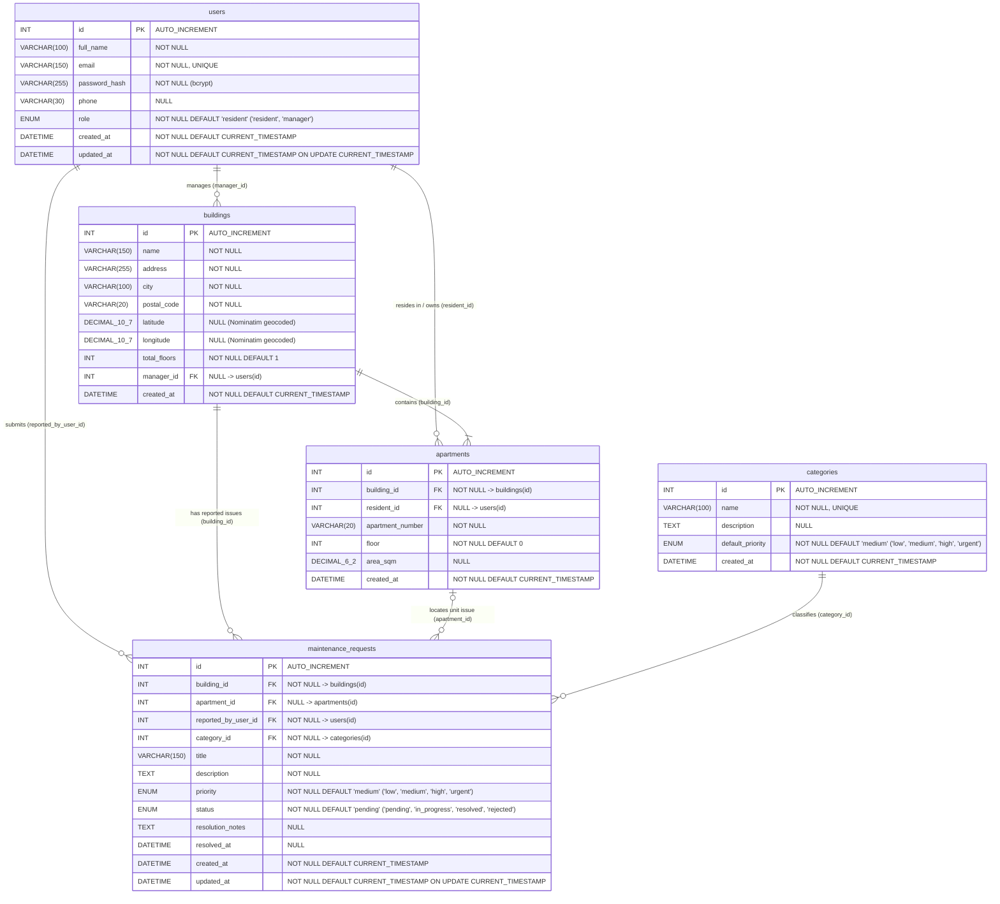

# Database Schema & Entity-Relationship Specification — Haustor.ba

**Project:** Haustor.ba — Apartment Building Management & Maintenance Reporting  
**Course:** IT-2001 Web Programming  
**Database Engine:** MySQL 8.0+ / MariaDB (InnoDB, `utf8mb4_unicode_ci`)  

---

## 1. Overview

The **Haustor.ba** database (`haustor_db`) models residential apartment building management, resident unit assignments, issue classification, and end-to-end maintenance request tracking. All tables use the `InnoDB` storage engine to enforce referential integrity via foreign key constraints and support transactional safety accessed exclusively through PHP PDO prepared statements.

---

## 2. Entity-Relationship Diagram (Mermaid ERD)

---

## 3. Detailed Entity Specifications & Data Dictionaries

### 3.1. `users`
Stores all registered system users, including residents and building managers (*upravitelji*).

| Column | Data Type | Nullability | Key / Constraints | Default | Description |
| :--- | :--- | :--- | :--- | :--- | :--- |
| `id` | `INT UNSIGNED` | `NOT NULL` | **PK**, `AUTO_INCREMENT` | — | Unique identifier for the user |
| `full_name` | `VARCHAR(100)` | `NOT NULL` | — | — | User's full first and last name |
| `email` | `VARCHAR(150)` | `NOT NULL` | **UNIQUE** (`uq_users_email`) | — | Login email address |
| `password_hash` | `VARCHAR(255)` | `NOT NULL` | — | — | Bcrypt hashed password (`password_hash()`) |
| `phone` | `VARCHAR(30)` | `NULL` | — | `NULL` | Optional contact phone number |
| `role` | `ENUM('resident', 'manager')` | `NOT NULL` | — | `'resident'` | Access control role used by JWT RBAC middleware |
| `created_at` | `DATETIME` | `NOT NULL` | — | `CURRENT_TIMESTAMP` | Account registration timestamp |
| `updated_at` | `DATETIME` | `NOT NULL` | — | `CURRENT_TIMESTAMP` | Last profile update timestamp (`ON UPDATE CURRENT_TIMESTAMP`) |

---

### 3.2. `buildings`
Stores residential apartment buildings managed on the platform, including optional coordinates populated via the OpenStreetMap Nominatim geocoding service.

| Column | Data Type | Nullability | Key / Constraints | Default | Description |
| :--- | :--- | :--- | :--- | :--- | :--- |
| `id` | `INT UNSIGNED` | `NOT NULL` | **PK**, `AUTO_INCREMENT` | — | Unique identifier for the building |
| `name` | `VARCHAR(150)` | `NOT NULL` | — | — | Building display name or entrance label (e.g., *Haustor Zmaja od Bosne 14*) |
| `address` | `VARCHAR(255)` | `NOT NULL` | — | — | Street name and street number |
| `city` | `VARCHAR(100)` | `NOT NULL` | — | — | City / municipality name (e.g., *Sarajevo*) |
| `postal_code` | `VARCHAR(20)` | `NOT NULL` | — | — | Postal / ZIP code (e.g., *71000*) |
| `latitude` | `DECIMAL(10,7)` | `NULL` | — | `NULL` | Geocoded latitude from OpenStreetMap Nominatim |
| `longitude` | `DECIMAL(10,7)` | `NULL` | — | `NULL` | Geocoded longitude from OpenStreetMap Nominatim |
| `total_floors` | `INT` | `NOT NULL` | — | `1` | Total number of floors in the building |
| `manager_id` | `INT UNSIGNED` | `NULL` | **FK** -> `users(id)` | `NULL` | Assigned building manager (`ON DELETE SET NULL`) |
| `created_at` | `DATETIME` | `NOT NULL` | — | `CURRENT_TIMESTAMP` | Record creation timestamp |

---

### 3.3. `apartments`
Represents individual residential units within a specific building and links them to their assigned resident user.

| Column | Data Type | Nullability | Key / Constraints | Default | Description |
| :--- | :--- | :--- | :--- | :--- | :--- |
| `id` | `INT UNSIGNED` | `NOT NULL` | **PK**, `AUTO_INCREMENT` | — | Unique identifier for the apartment unit |
| `building_id` | `INT UNSIGNED` | `NOT NULL` | **FK** -> `buildings(id)`, **UNIQUE** (`building_id`, `apartment_number`) | — | Parent building containing this apartment |
| `resident_id` | `INT UNSIGNED` | `NULL` | **FK** -> `users(id)` | `NULL` | Primary resident assigned to the apartment (`NULL` if vacant) |
| `apartment_number` | `VARCHAR(20)` | `NOT NULL` | Composite **UNIQUE** with `building_id` | — | Door / unit identifier (e.g., `1A`, `12`, `S-04`) |
| `floor` | `INT` | `NOT NULL` | — | `0` | Floor number (`0` for ground floor / *prizemlje*) |
| `area_sqm` | `DECIMAL(6,2)` | `NULL` | — | `NULL` | Apartment surface area in square meters ($m^2$) |
| `created_at` | `DATETIME` | `NOT NULL` | — | `CURRENT_TIMESTAMP` | Record creation timestamp |

---

### 3.4. `categories`
Defines standardized maintenance categories and default urgency levels for issue classification.

| Column | Data Type | Nullability | Key / Constraints | Default | Description |
| :--- | :--- | :--- | :--- | :--- | :--- |
| `id` | `INT UNSIGNED` | `NOT NULL` | **PK**, `AUTO_INCREMENT` | — | Unique identifier for the category |
| `name` | `VARCHAR(100)` | `NOT NULL` | **UNIQUE** (`uq_categories_name`) | — | Category title (e.g., *Plumbing & Water*, *Elevator*, *Electrical*) |
| `description` | `TEXT` | `NULL` | — | `NULL` | Guidelines on what issues belong to this category |
| `default_priority` | `ENUM('low', 'medium', 'high', 'urgent')` | `NOT NULL` | — | `'medium'` | Default priority level assigned when selected |
| `created_at` | `DATETIME` | `NOT NULL` | — | `CURRENT_TIMESTAMP` | Record creation timestamp |

---

### 3.5. `maintenance_requests`
Tracks maintenance and repair tickets reported by residents from submission through resolution.

| Column | Data Type | Nullability | Key / Constraints | Default | Description |
| :--- | :--- | :--- | :--- | :--- | :--- |
| `id` | `INT UNSIGNED` | `NOT NULL` | **PK**, `AUTO_INCREMENT` | — | Unique identifier for the maintenance ticket |
| `building_id` | `INT UNSIGNED` | `NOT NULL` | **FK** -> `buildings(id)` | — | Building where the issue occurred |
| `apartment_id` | `INT UNSIGNED` | `NULL` | **FK** -> `apartments(id)` | `NULL` | Specific apartment unit, or `NULL` for shared/common area issues |
| `reported_by_user_id` | `INT UNSIGNED` | `NOT NULL` | **FK** -> `users(id)` | — | User who submitted the maintenance request |
| `category_id` | `INT UNSIGNED` | `NOT NULL` | **FK** -> `categories(id)` | — | Classification category of the issue |
| `title` | `VARCHAR(150)` | `NOT NULL` | — | — | Short summary of the problem |
| `description` | `TEXT` | `NOT NULL` | — | — | Detailed description and location notes |
| `priority` | `ENUM('low', 'medium', 'high', 'urgent')` | `NOT NULL` | — | `'medium'` | Urgency level of the request |
| `status` | `ENUM('pending', 'in_progress', 'resolved', 'rejected')` | `NOT NULL` | — | `'pending'` | Current lifecycle status of the repair |
| `resolution_notes` | `TEXT` | `NULL` | — | `NULL` | Manager notes explaining repair actions or rejection reason |
| `resolved_at` | `DATETIME` | `NULL` | — | `NULL` | Timestamp when status transitioned to `resolved` |
| `created_at` | `DATETIME` | `NOT NULL` | — | `CURRENT_TIMESTAMP` | Submission timestamp |
| `updated_at` | `DATETIME` | `NOT NULL` | — | `CURRENT_TIMESTAMP` | Last update timestamp (`ON UPDATE CURRENT_TIMESTAMP`) |

---

## 4. Foreign Key Constraints & Referential Actions

| Child Table | Foreign Key Column | Referenced Parent Table | `ON DELETE` Action | `ON UPDATE` Action | Rationale |
| :--- | :--- | :--- | :--- | :--- | :--- |
| `buildings` | `manager_id` | `users(id)` | `SET NULL` | `CASCADE` | Removing a manager account preserves the building record so a new manager can be assigned. |
| `apartments` | `building_id` | `buildings(id)` | `CASCADE` | `CASCADE` | Apartments cannot exist independently of their physical building. |
| `apartments` | `resident_id` | `users(id)` | `SET NULL` | `CASCADE` | Deleting a resident account marks the apartment unit as vacant (`resident_id = NULL`) without deleting the unit. |
| `maintenance_requests` | `building_id` | `buildings(id)` | `CASCADE` | `CASCADE` | Deleting a building removes all maintenance tickets tied to that building. |
| `maintenance_requests` | `apartment_id` | `apartments(id)` | `SET NULL` | `CASCADE` | If an apartment record is removed, historical maintenance requests remain bound to the building with `apartment_id = NULL`. |
| `maintenance_requests` | `reported_by_user_id` | `users(id)` | `CASCADE` | `CASCADE` | Associates every active request with a valid reporter account. |
| `maintenance_requests` | `category_id` | `categories(id)` | `RESTRICT` | `CASCADE` | Prevents accidental deletion of a category that is still referenced by existing maintenance tickets. |
